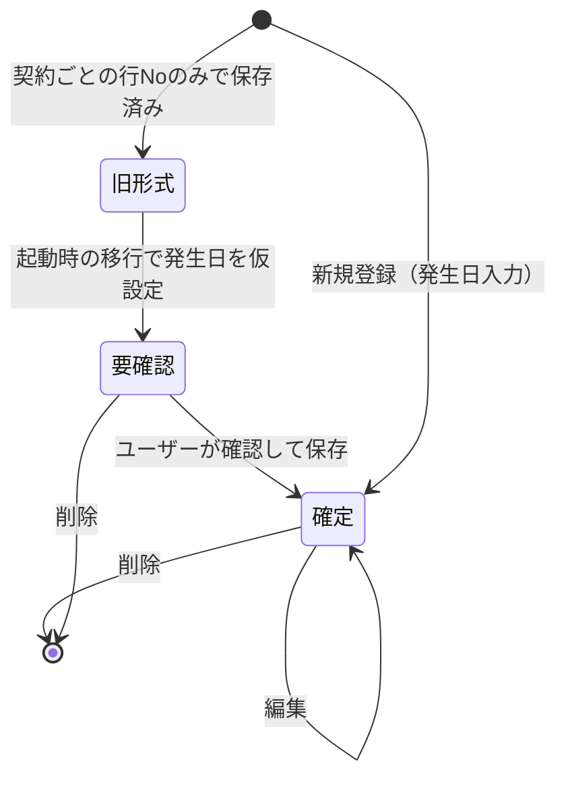

# Feature Specification: その他経費の発生日対応（正本整合） (other-expense-occurrence-date)

**Feature Branch**: `014-other-expense-occurrence-date`

**Created**: 2026-10-23

**Updated**: 2026-10-25（正本の主キー変更「契約ID ＋ 発生日 ＋ 行No」に追従）

**Status**: Implemented

**Input**: User description: "先に別のフィーチャー（014 など）でその他経費を正本に合わせ、013 はその完了後に進める"

## 概要

正本 [domain-model.md](../../.specify/memory/domain-model.md)（2026-10-25 版）では、`その他経費` の主キーは **契約ID ＋ 発生日 ＋ 行No** であり、`発生年月` を導出項目として持つ。現在の実装は **契約ID ＋ 行No** をキーとしており、発生日を持たないため、経費を年月に割り当てられない。

本フィーチャーでは `その他経費` を正本に整合させる。これは [013-case-cost-performance-summary](../013-case-cost-performance-summary/spec.md)（月別原価・四半期業績サマリ）の前提条件である。

> [!IMPORTANT]
> **行No の採番範囲が変わる**（2026-10-25 決定）: 現在は「契約ごとの通し番号」だが、本フィーチャー以降は **同じ契約・同じ発生日の中で 1, 2, 3… と採番** する（発生日が変わると 1 に戻る）。同じ日に複数の経費を登録できる。

### ユビキタス言語辞書

| 業務上の用語 | コード内の英語表記 | 説明 |
| :--- | :--- | :--- |
| その他経費 | `OtherExpense` | 契約に紐づく、加工費・発注額以外の経費 |
| 契約ID | `caseAssignmentId` | 案件明細の識別子（`CON` / `WK` で始まる） |
| 発生日 | `occurrenceDate` | 経費が発生した日（YYYY-MM-DD） |
| 行No | `lineNo` | 同じ契約・同じ発生日の中での連番（1 始まり） |
| 発生年月 | `occurrenceYearMonth` | 発生日の属する年月（YYYY-MM-01）。導出項目 |
| 金額 | `amount` | 経費の金額（円、0 以上の整数） |
| 摘要 | `memo` | 経費の内容説明 |
| 要確認 | `needsReview` | 移行時に発生日を仮設定した経費であることを示す表示 |

## User Scenarios & Testing *(mandatory)*

### User Story 1 - 発生日を指定した経費の登録 (Priority: P1) 🎯 MVP

経費入力画面で、契約を選び、発生日・金額・摘要を入力して経費を登録する。行No と発生年月は自動で決まる。

**Why this priority**:
経費を月単位で集計する（013 の月別原価）ための最低条件であり、正本との不整合を解消する中核機能のため。

**Independent Test**:
CON001 に発生日 2026-09-05・金額 30,000・摘要「書籍購入」を登録し、一覧に発生日 2026-09-05・行No 1・発生年月 2026-09 で表示されることを確認する。

**Acceptance Scenarios**:

1. **Given** 契約 CON001 が登録されているとき、
   **When** ユーザーが発生日 `2026-09-05`、金額 `30000`、摘要 `書籍購入` を入力して登録したとき、
   **Then** 経費が登録され、一覧に発生日 `2026-09-05`、行No `1`、発生年月 `2026-09` として表示されること。
2. **Given** CON001 に発生日 `2026-08-20`・行No `1` の経費が既に登録されているとき、
   **When** ユーザーが CON001・発生日 `2026-08-20` の経費をもう 1 件登録したとき、
   **Then** 行No `2` として登録されること。
3. **Given** CON001 に発生日 `2026-08-20`・行No `1` の経費だけがあるとき、
   **When** ユーザーが CON001・発生日 `2026-08-21` の経費を登録したとき、
   **Then** 行No `1` として登録されること（発生日が変わると 1 から採番）。
4. **Given** 経費入力フォームを開いているとき、
   **When** ユーザーが発生日を未入力のまま登録しようとしたとき、
   **Then** 「発生日は必須です」と表示され、登録されないこと。
5. **Given** 経費入力フォームを開いているとき、
   **When** ユーザーが存在しない日付（例: `2026-02-30`）や YYYY-MM-DD 以外の形式を入力したとき、
   **Then** 「発生日は YYYY-MM-DD 形式の有効な日付で入力してください」と表示され、登録されないこと。

---

### User Story 2 - 経費一覧の発生日表示と並び順 (Priority: P1)

経費一覧に発生日・行No・発生年月を表示し、発生日の昇順、同日内は行No の昇順で並べる。

**Why this priority**:
利用者が経費を発生日単位で識別・確認できるようにするため。

**Independent Test**:
初期シードデータで経費一覧を開き、正本のシードデータ 3 件が発生日・行No・発生年月付きで表示されることを確認する。

**Acceptance Scenarios**:

1. **Given** 初期シードデータが登録されているとき、
   **When** ユーザーが経費入力画面で各契約を選んだとき、
   **Then** 以下のとおり表示されること。

   | 契約ID | 発生日 | 行No | 発生年月 | 金額 | 摘要 |
   | --- | --- | --- | --- | --- | --- |
   | CON001 | 2026-08-20 | 1 | 2026-08 | 15,000 | 開発環境クラウド利用料 |
   | CON002 | 2026-10-15 | 1 | 2026-10 | 20,000 | 外部打ち合わせ用会議室費 |
   | CON003 | 2026-11-10 | 1 | 2026-11 | 12,000 | 現地調査用交通費 |

2. **Given** 1 つの契約に複数の経費があるとき、
   **Then** 発生日の昇順、同じ発生日の中では行No の昇順で表示されること。

---

### User Story 3 - 経費の編集・削除 (Priority: P1)

登録済みの経費の金額・摘要・発生日を編集、または削除する。

**Why this priority**:
誤入力の訂正、および移行で仮設定された発生日の確定（US4）に必要なため。

**Independent Test**:
CON001・2026-08-20・行No 1 の経費の発生日を 2026-08-25 に変更し、一覧で発生日・行No・発生年月が更新されていることを確認する。

**Acceptance Scenarios**:

1. **Given** CON001・発生日 `2026-08-20`・行No `1` の経費があるとき、
   **When** ユーザーが金額を `18000` に変更して保存したとき、
   **Then** 一覧の金額が `18,000` になり、発生日・行No は変わらないこと。
2. **Given** CON001・発生日 `2026-08-20`・行No `1` の経費があるとき、
   **When** ユーザーが発生日を `2026-09-01`（CON001 に同日の経費なし）に変更して保存したとき、
   **Then** 発生日 `2026-09-01`・行No `1`・発生年月 `2026-09` として表示され、元の `2026-08-20`・行No `1` の経費は存在しないこと。
3. **Given** CON001 に発生日 `2026-08-20`・行No `1` と、発生日 `2026-09-05`・行No `1` の経費があるとき、
   **When** ユーザーが `2026-09-05` の経費の発生日を `2026-08-20` に変更して保存したとき、
   **Then** その経費は発生日 `2026-08-20`・行No `2` になり、既存の `2026-08-20`・行No `1` の経費は変わらないこと。
4. **Given** CON001・発生日 `2026-08-20` に行No `1`・`2` の経費があるとき、
   **When** ユーザーが行No `1` を削除したとき、
   **Then** 行No `1` の経費が一覧から消え、行No `2` の経費は行No `2` のまま残ること（採番し直さない）。

---

### User Story 4 - 発生日のない保存済みデータの移行 (Priority: P1)

アプリ起動時、発生日を持たない旧形式の経費を、契約の開始日を仮の発生日として新形式に移行し、「要確認」として表示する。

**Why this priority**:
既存の利用者の経費データを失わずに新形式へ切り替えるため。

**Independent Test**:
旧形式の経費 2 件（CON001、旧行No 1 と 3）を保存した状態で起動し、発生日 2026-08-15・行No 1 と 2 の「要確認」経費として表示されることを確認する。

**Acceptance Scenarios**:

1. **Given** 旧形式で CON001（案件開始日 `2026-08-15`）の経費が旧行No `1` の 1 件だけ保存されているとき、
   **When** アプリを起動したとき、
   **Then** 発生日 `2026-08-15`・行No `1` の経費として移行され、一覧に「要確認」と表示されること。金額・摘要は変わらないこと。
2. **Given** 旧形式で CON001 の経費が旧行No `1`・`3` の 2 件保存されているとき、
   **When** アプリを起動したとき、
   **Then** 旧行No の昇順に、発生日 `2026-08-15`・行No `1` と `2` として移行されること。
3. **Given** CON001・発生日 `2026-08-15` に新形式の経費（行No `1`）が既にあるとき、
   **When** 旧形式の CON001 の経費 1 件が移行されたとき、
   **Then** 発生日 `2026-08-15`・行No `2` として移行され、既存の経費は変わらないこと。
4. **Given** 「要確認」の経費があるとき、
   **When** ユーザーがその経費を編集画面で保存したとき（発生日を変更しない場合も含む）、
   **Then** 「要確認」表示が消えること。
5. **Given** 移行が一度完了したとき、
   **When** アプリを再起動したとき、
   **Then** 移行は再実行されず、データは変化しないこと。
6. **Given** 旧形式の経費の契約ID に対応する案件明細が存在しないとき、
   **When** 移行が行われたとき、
   **Then** その経費は移行されず、「移行できなかった経費 N 件」が契約ID・金額・摘要とともに画面に通知されること。

---

### Edge Cases

- **発生日が契約期間外**: 正本に制約が無いため登録を許可する（013 の月別原価でもその月に計上される）。
- **行No の欠番**: 削除によって生じた欠番は詰めない。新規登録時は、同じ契約・同じ発生日の中の最大行No ＋ 1 を採番する。
- **データのインポート（データ入出力画面）で旧形式のファイルを取り込んだとき**: 起動時と同じ移行規則を適用する。
- **データ初期化（シード復元）**: 正本のシードデータ 3 件（発生日・行No 付き）が登録される。
- **案件明細の売上・原価表示（F05b）**: 経費の合計金額の計算は従来どおり契約ID 単位で行い、結果は変わらない。

## Requirements *(mandatory)*

### Functional Requirements

- **FR-001**: その他経費は、契約ID・発生日・行No・発生年月・金額・摘要を持たなければならない。
- **FR-002**: その他経費は、契約ID・発生日・行No の組で一意に識別されなければならない。
- **FR-003**: 発生日は必須であり、YYYY-MM-DD 形式の実在する日付でなければならない。
- **FR-004**: 行No は 1 以上の整数で、同じ契約・同じ発生日の中で一意でなければならない。新規登録時は、同じ契約・同じ発生日の既存経費の最大行No ＋ 1（無ければ 1）を自動採番し、利用者は直接入力できてはならない。
- **FR-005**: 発生年月は、発生日の属する年月を YYYY-MM-01 形式で設定した導出項目でなければならない。利用者が直接入力・変更できてはならない。
- **FR-006**: 契約ID は `CON` または `WK` で始まる、登録済みの案件明細の契約ID でなければならない（既存ルールの継承）。
- **FR-007**: 金額は 0 以上の整数でなければならない（既存ルールの継承）。
- **FR-008**: 摘要は必須で、100 文字以内でなければならない（既存ルールの継承）。
- **FR-009**: 経費一覧は発生日・行No・発生年月・金額・摘要を表示し、発生日の昇順、同日内は行No の昇順に並べなければならない。
- **FR-010**: 経費の編集では、金額・摘要・発生日を変更できなければならない。発生日を変更した場合は、変更後の発生日で FR-004 の規則により行No を採番し直さなければならない。発生日を変更しない場合、行No は変わってはならない。
- **FR-011**: アプリ起動時およびデータのインポート時に、発生日を持たない旧形式の経費を次の規則で移行しなければならない。
  - 契約ごとに旧行No の昇順で処理する。
  - 発生日は、契約（案件明細）の案件開始日とする。
  - 行No は FR-004 の規則で採番する（同日に既存経費があれば、その最大行No の次から）。
  - 金額・摘要・契約ID は変更しない。
  - 移行した経費には「要確認」の印を付ける。
- **FR-012**: 対応する案件明細が存在しない旧形式の経費は移行せず、件数と内容（契約ID・金額・摘要）を利用者に通知しなければならない。
- **FR-013**: 移行は冪等でなければならない。新形式のデータに対して再実行してもデータが変化してはならない。
- **FR-014**: 「要確認」の印は、利用者がその経費を保存した時点で外れなければならない。
- **FR-015**: シード（初期）データは、正本 domain-model.md の `その他経費` のシードデータ 3 件と一致しなければならない。
- **FR-016**: 経費の変更は `その他経費` 集約のみに対して行い、他の集約へ書き込んではならない（単一トランザクション・単一集約原則）。

### Key Entities

- **その他経費**: 契約ID × 発生日 × 行No で識別される経費。発生年月（導出）・金額・摘要を持つ。
- **案件明細**（参照のみ）: 契約ID の存在確認、および移行時の仮の発生日（案件開始日）の取得元。

## Success Criteria *(mandatory)*

### Measurable Outcomes

- **SC-001**: 初期シードデータで、経費一覧の 3 件が正本のシードデータと全項目一致する。
- **SC-002**: 旧形式で保存されていた経費は、案件明細が存在するものについて 100% が金額・摘要を保ったまま新形式に移行される。
- **SC-003**: 移行を何度実行しても、2 回目以降にデータが 1 件も変化しない。
- **SC-004**: 利用者は、発生日付きの経費を 30 秒以内に 1 件登録できる。
- **SC-005**: 本フィーチャー完了後、013 の月別原価サマリが「契約ID × 発生年月」で経費を集計できる状態になる。

## Assumptions

- 主キーは正本（2026-10-25 版）どおり「契約ID ＋ 発生日 ＋ 行No」とする。
- 行No は同じ契約・同じ発生日の中で採番する（2026-10-25 決定）。正本には採番範囲の記載がないため、本仕様の決定を正本の補足として扱う。
- 移行時の仮の発生日は契約の案件開始日とする（2026-10-23 決定）。行No で区別できるため、日付をずらす処理は行わない。
- 「要確認」の印は移行のための一時的な情報であり、正本のスキーマには追加しない。保存場所は計画フェーズで決定する。
- CRUD マトリクス上の F10（その他経費入力）の担当集約・参照集約は変わらない。
- 案件明細の製造原価への経費の合算方法（F05b）は変更しない。
